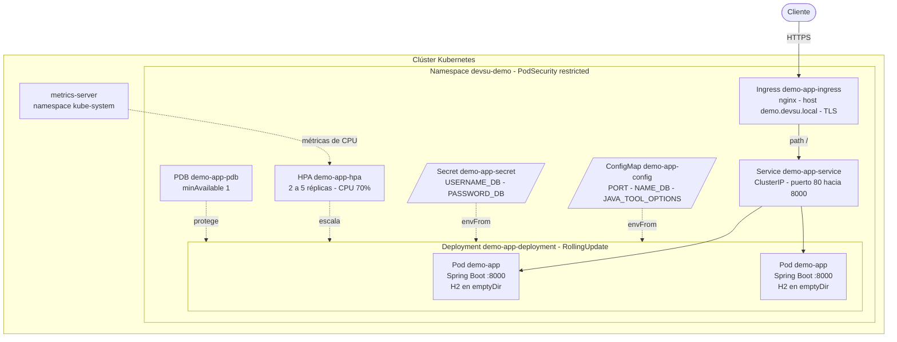
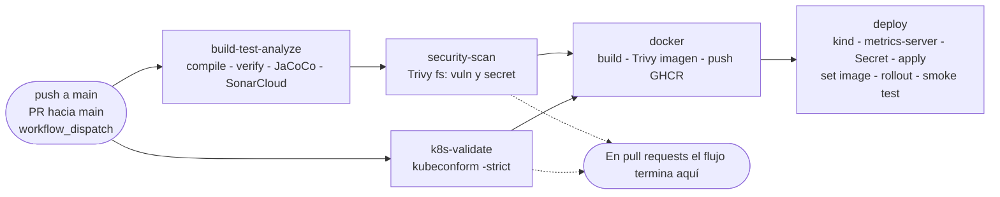
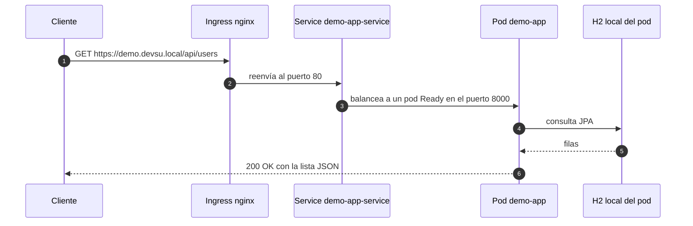
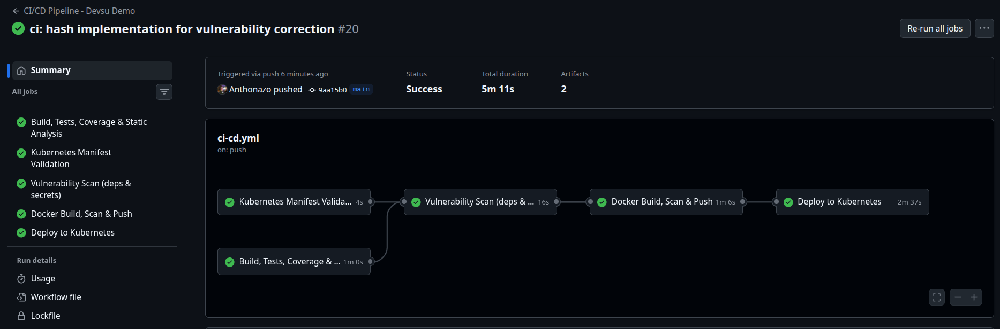
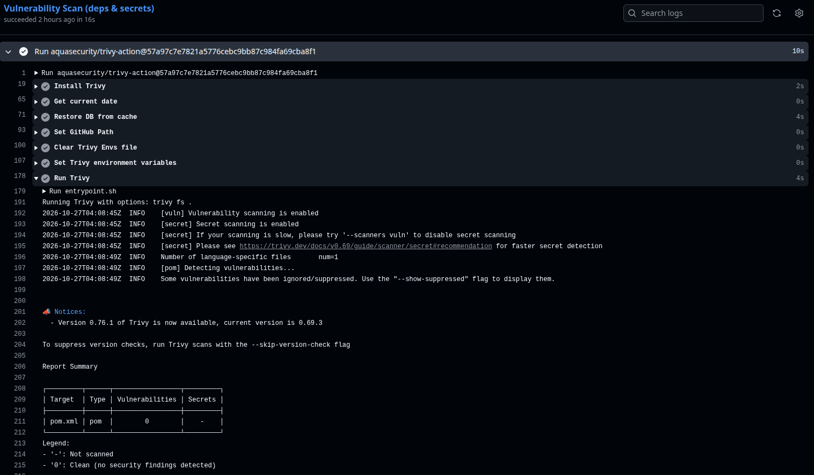
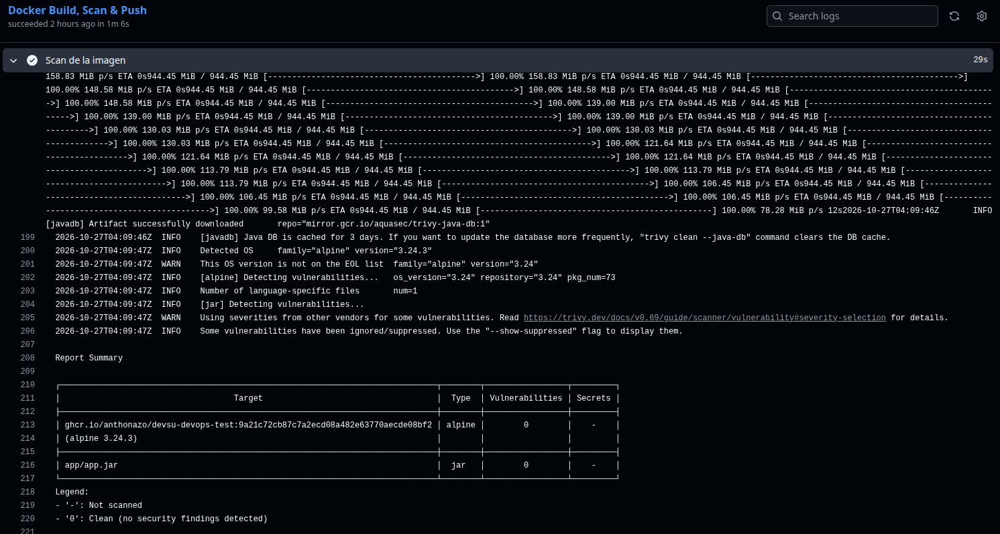
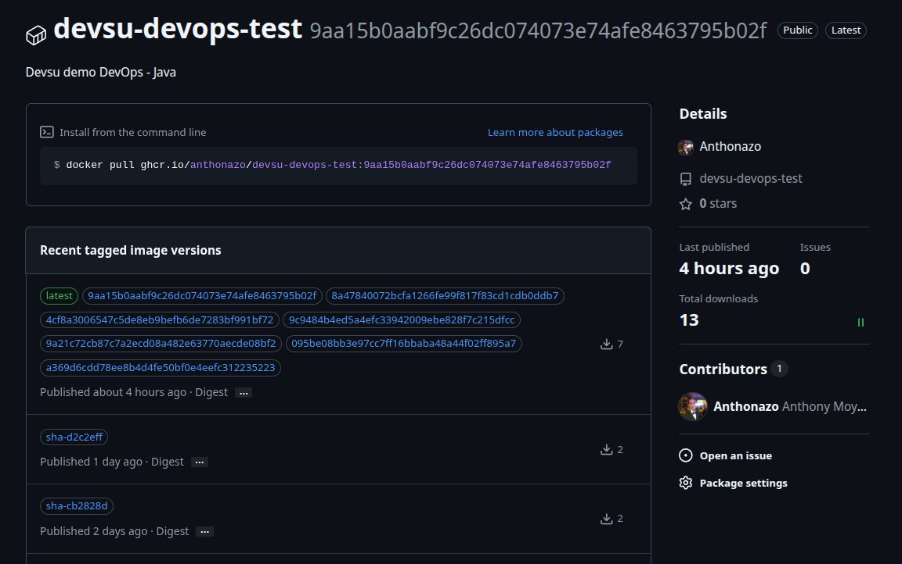
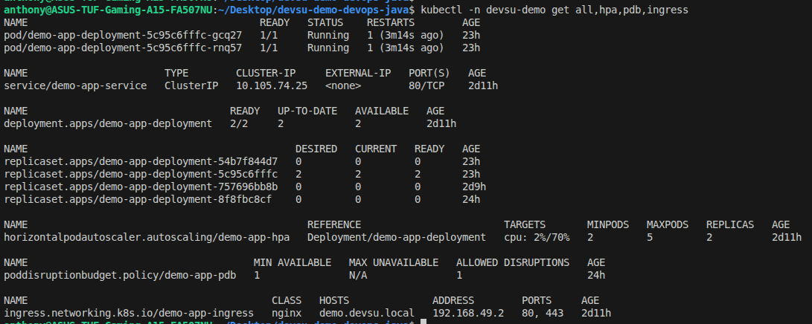
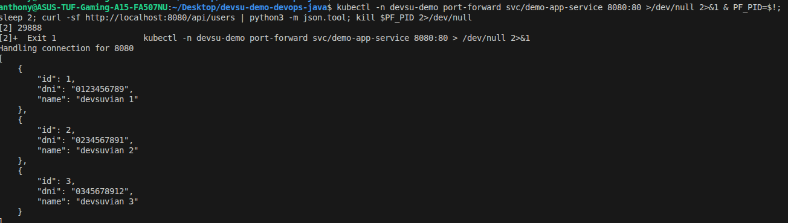

# Demo DevOps Java — Prueba técnica DevOps

La aplicación (Java 17, Spring Boot 3.0.5, API REST de usuarios con base H2) viene del **proyecto base de la prueba**, y su código en `src/` no es de mi autoria. Lo que desarrollé es la capa DevOps:

- **Dockerfile** multi-stage, con usuario no root y HEALTHCHECK.
- **Pipeline CI/CD** en GitHub Actions: build, pruebas, cobertura, análisis estático, escaneo de vulnerabilidades, validación de manifiestos, build y push de la imagen, y despliegue en un clúster Kubernetes efímero (kind) con smoke test.
- **Manifiestos de Kubernetes** endurecidos: PodSecurity `restricted`, probes, HPA, PDB e Ingress con TLS.
- **Calidad y seguridad**: JaCoCo, SonarCloud, Trivy (filesystem e imagen) y kubeconform.

Repositorio: `https://github.com/Anthonazo/devsu-devops-test` (tomado de `.git/config` y del `LABEL org.opencontainers.image.source` del Dockerfile).
Imagen: `ghcr.io/anthonazo/devsu-devops-test` (tags `<sha>` y `latest`).

---

## Índice

1. [Cumplimiento de requerimientos](#1-cumplimiento-de-requerimientos)
2. [Arquitectura](#2-arquitectura)
3. [Estructura del repositorio](#3-estructura-del-repositorio)
4. [Ejecución local y despliegue](#4-ejecución-local-y-despliegue)
5. [Docker](#5-docker)
6. [Pipeline CI/CD](#6-pipeline-cicd)
7. [Kubernetes](#7-kubernetes)
8. [Seguridad y calidad](#8-seguridad-y-calidad)
9. [Decisiones, limitaciones y trade-offs](#9-decisiones-limitaciones-y-trade-offs)
10. [Consideraciones para producción](#10-consideraciones-para-producción)
11. [Evidencias](#11-evidencias)

---

## 1. Cumplimiento de requerimientos

| Requerimiento | Estado | Dónde verlo | Nota |
|---|---|---|---|
| Dockerizar: variables de entorno | Cumplido | `Dockerfile` (`ENV`), `k8s/01-configmap.yaml` | `PORT`, `NAME_DB` y `JAVA_TOOL_OPTIONS` tienen valores por defecto en la imagen y el ConfigMap los sobrescribe en Kubernetes. Las credenciales (`USERNAME_DB`, `PASSWORD_DB`) no van en la imagen: llegan desde un Secret. |
| Dockerizar: usuario de ejecución | Cumplido | `Dockerfile` (`USER 1000:1000`) | Usuario y grupo dedicados, con UID numérico para que Kubernetes pueda verificar `runAsNonRoot`. |
| Dockerizar: puerto | Cumplido | `Dockerfile` (`EXPOSE 8000`) | Coincide con `server.port=${PORT: 8000}` de `application.properties`. |
| Dockerizar: healthcheck | Cumplido | `Dockerfile` (`HEALTHCHECK`), `k8s/03-deployment.yaml` (probes) | El HEALTHCHECK consulta `/api/actuator/health`. En Kubernetes lo reemplazan las probes startup, liveness y readiness. |
| Pipeline: code build | Cumplido | job `build-test-analyze`, paso *Code Build* | `./mvnw -B clean compile` |
| Pipeline: unit tests | Cumplido | job `build-test-analyze`, paso *Unit Tests + Coverage* | `./mvnw -B verify`. Los reportes de Surefire se publican como artefacto. |
| Pipeline: static code analysis | Cumplido | job `build-test-analyze`, paso *Static Code Analysis (SonarCloud)* | El Quality Gate no bloquea el pipeline (ver §8). |
| Pipeline: code coverage | Cumplido | `pom.xml` (jacoco-maven-plugin 0.8.11), artefacto `test-and-coverage-reports` | JaCoCo solo mide y reporta; no hay umbral mínimo que rompa el build (ver §9). |
| Pipeline: Docker build & push | Cumplido | job `docker` | La imagen se construye una sola vez, se escanea y se publica esa misma imagen en GHCR. Solo en `push` y `workflow_dispatch`, no en pull requests. |
| Pipeline: vulnerability scan | Cumplido | jobs `security-scan` (filesystem) y `docker` (imagen) | Bloqueante solo para vulnerabilidades **CRITICAL con fix disponible** (ver §8). |
| Kubernetes: 2+ réplicas | Cumplido | `k8s/03-deployment.yaml` (`replicas: 2`), `k8s/05-hpa.yaml` (`minReplicas: 2`) | |
| Kubernetes: escalamiento horizontal | Cumplido | `k8s/05-hpa.yaml` | HPA `autoscaling/v2` por CPU, de 2 a 5 réplicas, con `behavior`. En el pipeline se instala metrics-server para que funcione. |
| Kubernetes: ConfigMap | Cumplido | `k8s/01-configmap.yaml` | |
| Kubernetes: Secret | Cumplido | job `deploy` (se crea desde GitHub Secrets), `k8s/examples/secret.example.yaml` (plantilla) | No hay credenciales en el repositorio. |
| Kubernetes: Ingress | Cumplido | `k8s/06-ingress.yaml` | El recurso está definido para ingress-nginx con TLS, pero kind no trae un controlador de Ingress, así que en el pipeline el Ingress se crea sin ADDRESS (ver §9). |
| Despliegue dentro del pipeline | Cumplido | job `deploy` | Clúster efímero con kind, rollout y smoke test. |
| README con diagramas | Cumplido | este archivo | Los diagramas están en Mermaid y GitHub los renderiza. |

---

## 2. Arquitectura

### 2.a Arquitectura en Kubernetes



### 2.b Flujo del pipeline



`k8s-validate` no depende de nadie y corre en paralelo con `build-test-analyze`. El job `docker` espera a `security-scan` y a `k8s-validate`, y `deploy` espera a `docker`.

### 2.c Secuencia de una petición



Solo reciben tráfico los pods que pasan la readiness probe. Como cada pod tiene su propia H2, dos peticiones seguidas pueden caer en pods con datos distintos (ver §9).

---

## 3. Estructura del repositorio

```text
.
├── .github/workflows/ci-cd.yml      # Pipeline CI/CD (mío)
├── k8s/                              # Manifiestos Kubernetes (míos)
│   ├── 00-namespace.yaml            #   Namespace con PodSecurity restricted
│   ├── 01-configmap.yaml            #   Configuración no sensible
│   ├── 03-deployment.yaml           #   Deployment endurecido
│   ├── 04-service.yaml              #   Service ClusterIP
│   ├── 05-hpa.yaml                  #   HorizontalPodAutoscaler
│   ├── 06-ingress.yaml              #   Ingress nginx + TLS
│   ├── 07-pdb.yaml                  #   PodDisruptionBudget
│   └── examples/
│       └── secret.example.yaml      #   Plantilla del Secret (no se aplica)
├── Dockerfile                        # Imagen multi-stage (mío)
├── .dockerignore                     # Contexto de build mínimo (mío)
├── .trivyignore                      # Supresiones de CVE con caducidad (mío)
├── .gitignore
├── pom.xml                           # Proyecto base + JaCoCo y propiedades de SonarCloud
├── mvnw, mvnw.cmd, .mvn/wrapper/     # Maven Wrapper (Maven 3.8.7)
└── src/                              # Código de la aplicación (proyecto base)
    ├── main/java/devsu/devops/demo/
    ├── main/resources/application.properties
    ├── main/resources/data.sql
    └── test/java/devsu/devops/demo/
```

La numeración de `k8s/` define el orden de aplicación (`kubectl apply -f k8s/` procesa los archivos alfabéticamente). El número `02` queda libre a propósito: corresponde al Secret, que no se versiona y se crea en el pipeline. `kubectl apply -f k8s/` no es recursivo, por eso la plantilla de `k8s/examples/` nunca se aplica por accidente.

---

## 4. Ejecución local y despliegue

### 4.1 Maven

```bash
./mvnw clean test          # pruebas unitarias + reporte JaCoCo en target/site/jacoco/
./mvnw spring-boot:run     # app en http://127.0.0.1:8000/api
```

En Windows se usa `mvnw.cmd` en lugar de `./mvnw`.

- Swagger UI: `http://127.0.0.1:8000/api/swagger-ui.html`
- Health: `http://127.0.0.1:8000/api/actuator/health`
- API: `GET/POST /api/users`, `GET /api/users/{id}`

Sin `NAME_DB`, la base H2 se crea como `./test.mv.db` en el directorio de trabajo (está en `.gitignore`).

### 4.2 Docker

```bash
docker build -t devsu-demo:local .
docker run --rm -p 8000:8000 \
  -e USERNAME_DB=user -e PASSWORD_DB=password \
  devsu-demo:local

curl http://localhost:8000/api/users
docker ps   # la columna STATUS muestra (healthy) cuando pasa el HEALTHCHECK
```

Si no se pasan `USERNAME_DB` y `PASSWORD_DB`, la app usa los valores por defecto de `application.properties` (`user` y `password`).

### 4.3 Kubernetes local (minikube o Docker Desktop)

Los comandos usan sintaxis bash. En PowerShell cambia el escape de comillas del `patch`.

```bash
# 1. Namespace (PodSecurity restricted)
kubectl apply -f k8s/00-namespace.yaml

# 2. Secret (no está versionado). Opción A: desde la línea de comandos
kubectl -n devsu-demo create secret generic demo-app-secret \
  --from-literal=USERNAME_DB=<usuario> \
  --from-literal=PASSWORD_DB=<password>
#    Opción B: copiar k8s/examples/secret.example.yaml fuera del repo, editarlo y aplicarlo

# 3. Resto de manifiestos
kubectl apply -f k8s/
kubectl -n devsu-demo rollout status deployment/demo-app-deployment

# 4. Probar a través del Service
kubectl -n devsu-demo port-forward svc/demo-app-service 8080:80
curl http://localhost:8080/api/users
```

**Imagen.** El Deployment apunta a `ghcr.io/anthonazo/devsu-devops-test:latest` con `imagePullPolicy: Always`, y no hay `imagePullSecrets`, así que el paquete de GHCR tiene que ser público. Para usar una imagen construida localmente:

```bash
docker build -t devsu-demo:local .
minikube image load devsu-demo:local        # en Docker Desktop no hace falta este paso
kubectl -n devsu-demo set image deployment/demo-app-deployment demo-app=devsu-demo:local
kubectl -n devsu-demo patch deployment demo-app-deployment --type=json \
  -p='[{"op":"replace","path":"/spec/template/spec/containers/0/imagePullPolicy","value":"IfNotPresent"}]'
```

**HPA.** Necesita metrics-server:

- minikube: `minikube addons enable metrics-server`
- Docker Desktop: el mismo procedimiento del pipeline (`components.yaml` de metrics-server v0.7.2 más el flag `--kubelet-insecure-tls`, que solo es aceptable en entornos de prueba).

```bash
kubectl -n devsu-demo get hpa demo-app-hpa
```

**Ingress (opcional).** Necesita ingress-nginx (`minikube addons enable ingress` o el manifiesto oficial en Docker Desktop) y una entrada `demo.devsu.local` en el archivo hosts que apunte a la IP del controlador. El Secret TLS `demo-app-tls` no existe en el repo, así que nginx sirve su certificado autofirmado por defecto:

```bash
curl -k https://demo.devsu.local/api/users
```

---

## 5. Docker

```dockerfile
FROM eclipse-temurin:17-jdk-alpine AS builder   # etapa 1: compila
FROM eclipse-temurin:17-jre-alpine AS runner    # etapa 2: solo JRE + app.jar
```

| Decisión | Implementación | Por qué |
|---|---|---|
| Multi-stage | `builder` (JDK) → `runner` (JRE) | El JDK, Maven, el código fuente y el repositorio local `.m2` no llegan a la imagen final. Menos tamaño y menos superficie de ataque. |
| Imagen base | `eclipse-temurin:17-jre-alpine` | Distribución OpenJDK mantenida, versión alineada con `java.version=17` del `pom.xml`, base Alpine pequeña. |
| Caché de dependencias | `COPY .mvn mvnw pom.xml` → `dependency:go-offline` → `COPY src` | La capa de dependencias solo se invalida si cambia el `pom.xml`. Un cambio en `src/` no vuelve a descargar dependencias. |
| Tests en el build de la imagen | `package -DskipTests` | Los tests ya corrieron en `build-test-analyze`. Repetirlos dentro del `docker build` duplicaría tiempo sin aportar señal nueva. |
| Usuario no root | `addgroup -g 1000`, `adduser -u 1000`, `USER 1000:1000` | Con un UID numérico, Kubernetes puede validar `runAsNonRoot: true`, cosa que no puede hacer con un nombre de usuario. |
| Permisos | `COPY --chown=appuser:appgroup`, `chown` de `/app` | El proceso solo puede escribir en `/app` (en particular en `/app/data`, donde va H2). |
| Variables de entorno | `PORT=8000`, `NAME_DB=jdbc:h2:file:/app/data/test`, `JAVA_TOOL_OPTIONS` | La imagen funciona sola con `docker run`. El ConfigMap repite los mismos valores para poder ajustarlos en Kubernetes sin reconstruir la imagen. |
| Flags de JVM | `-XX:MaxRAMPercentage=75.0 -XX:+UseG1GC -XX:+ExitOnOutOfMemoryError` | El heap se calcula sobre el límite de memoria del contenedor (unos 576 MiB con el límite de 768Mi), lo que deja margen para metaspace, threads y buffers. Con `ExitOnOutOfMemoryError`, ante un OOM el proceso termina y el orquestador lo reinicia, en vez de dejar una JVM degradada. |
| Puerto | `EXPOSE 8000` | Documenta el puerto en que escucha la app. |
| HEALTHCHECK | `wget` a `/api/actuator/health` cada 30 s, con `start-period=60s` | Sirve para `docker run` y Compose. `wget` viene con BusyBox en Alpine, así que no hace falta instalar `curl`. Kubernetes ignora el HEALTHCHECK y usa sus propias probes. |
| ENTRYPOINT en forma exec | `["java", "-jar", "/app/app.jar"]` | Java es el PID 1 y recibe `SIGTERM` directamente, lo que permite el apagado ordenado configurado en la app (`server.shutdown=graceful`). |
| Metadatos OCI | `LABEL org.opencontainers.image.source=...` | GHCR asocia el paquete al repositorio. |
| `tzdata` | `apk add --no-cache tzdata` | Datos de zona horaria disponibles si se define `TZ`. `--no-cache` evita dejar el índice de apk en la capa. |
| `.dockerignore` | Excluye `.git`, `.github/`, `k8s/`, `*.md`, `target/` y archivos de IDE | El contexto de build es más pequeño y los artefactos locales (`target/`) no contaminan la imagen. |

<!-- TODO: completar tamaño final de la imagen (salida de `docker images ghcr.io/anthonazo/devsu-devops-test`) -->

---

## 6. Pipeline CI/CD

Archivo: `.github/workflows/ci-cd.yml`.

### 6.1 Configuración global

| Elemento | Valor | Por qué |
|---|---|---|
| Disparadores | `push` y `pull_request` hacia `main`, `workflow_dispatch` | Los PR se validan antes del merge, y el pipeline se puede lanzar a mano. |
| `permissions` | `contents: read` a nivel workflow; `packages: write` solo en el job `docker` | Mínimo privilegio: solo el job que publica en GHCR tiene permiso de escritura. |
| `concurrency` | `group: workflow-ref`, `cancel-in-progress: true` | Un push nuevo a la misma rama cancela la ejecución anterior y evita runs redundantes. |
| `env.REGISTRY` | `ghcr.io` | Registro de contenedores integrado con GitHub. Se autentica con el `GITHUB_TOKEN` efímero, sin credenciales adicionales. |

### 6.2 Jobs

| Job | Depende de | Condición | Qué hace | Herramientas |
|---|---|---|---|---|
| `build-test-analyze` | — | siempre | Checkout con `fetch-depth: 0` (Sonar necesita el historial para blame y código nuevo) → Java 17 con caché de Maven → `clean compile` → `verify` (tests + reporte JaCoCo) → análisis SonarCloud → publica `target/site/jacoco/` y `target/surefire-reports/` como artefacto (`if: always()`, así quedan disponibles aunque fallen los tests). | Maven Wrapper, JUnit/Surefire, JaCoCo, SonarCloud |
| `security-scan` | `build-test-analyze` | siempre | Trivy en modo `fs` con `scanners: vuln,secret` sobre el repositorio: dependencias de Maven y secretos filtrados en el código. | Trivy (action fijada por SHA) |
| `k8s-validate` | — | siempre | Valida los manifiestos de `k8s/` contra los esquemas de Kubernetes con `kubeconform -strict` (rechaza campos desconocidos). No necesita clúster. | kubeconform v0.6.7 |
| `docker` | `security-scan`, `k8s-validate` | `github.event_name != 'pull_request'` | Construye la imagen una sola vez (`load: true`) con tags `<sha>` y `latest` → la escanea con Trivy → si pasa, publica esa misma imagen (`docker push --all-tags`). Usa la caché de GitHub Actions (`type=gha`, `mode=max`). El nombre del repositorio se pasa a minúsculas porque GHCR lo exige. | Docker Buildx, Trivy, GHCR |
| `deploy` | `docker` | implícita: si `docker` se omite (en PR), `deploy` también | Ver §6.3. Corre en el `environment: production` de GitHub, donde se pueden configurar reglas de protección (aprobadores) y secrets propios del ambiente. | kind, kubectl, metrics-server |

Las dependencias `needs` funcionan como compuertas: si fallan los tests, el escaneo de seguridad o la validación de manifiestos, no se construye ni se publica ninguna imagen.

### 6.3 Detalle del job `deploy`

1. **Clúster efímero:** `helm/kind-action@v1` levanta un clúster kind llamado `devsu` dentro del runner.
2. **metrics-server v0.7.2:** se instala y se parchea con `--kubelet-insecure-tls`, porque los kubelets de kind usan certificados autofirmados. Es aceptable solo en pruebas. Sin metrics-server, el HPA se queda en `<unknown>`.
3. **Secret:** se crea `demo-app-secret` a partir de `secrets.DB_USERNAME` y `secrets.DB_PASSWORD` con `--dry-run=client -o yaml | kubectl apply -f -`, que es idempotente. El valor nunca toca el repositorio.
4. **Manifiestos:** `kubectl apply -f k8s/`.
5. **Imagen inmutable:** `kubectl set image ... demo-app=<imagen>:<sha>`, para que lo desplegado sea exactamente la imagen escaneada en este run y no un `latest` que podría cambiar.
6. **Rollout:** `kubectl rollout status --timeout=240s`. Si los pods no llegan a Ready, el job falla.
7. **Smoke test:** `kubectl port-forward svc/demo-app-service 8080:80` y `curl -sf --retry 5 --retry-connrefused` a `/api/users`. Un código HTTP de error hace fallar el job.
8. **Métricas del HPA:** espera hasta 2 minutos (12 intentos de 10 s) a que el HPA reporte CPU. Es informativo: si no llegan, el paso no falla.
9. **Estado final** (`if: always()`): `kubectl get all,hpa,pdb,ingress` queda en el log como evidencia, incluso si un paso anterior falló.

### 6.4 Secrets necesarios

| Secret | Uso | Dónde se configura |
|---|---|---|
| `SONAR_TOKEN` | Autenticación con SonarCloud | Secrets del repositorio |
| `DB_USERNAME` | `USERNAME_DB` del Secret de Kubernetes | Secrets del repositorio o del environment `production` <!-- TODO: completar dónde quedaron definidos --> |
| `DB_PASSWORD` | `PASSWORD_DB` del Secret de Kubernetes | Igual que `DB_USERNAME` |
| `GITHUB_TOKEN` | Login en GHCR y decoración de Sonar | Automático (lo provee GitHub Actions) |

El análisis de SonarCloud solo corre en `push` o en PR desde el mismo repositorio (`github.event.pull_request.head.repo.full_name == github.repository`). Los PR desde forks no reciben secrets, y sin ese filtro el paso fallaría por falta de token.

---

## 7. Kubernetes

### 7.1 Recursos

| Archivo | Recurso | Por qué existe |
|---|---|---|
| `00-namespace.yaml` | Namespace `devsu-demo` | Aísla los recursos de la app y aplica `pod-security.kubernetes.io/enforce: restricted`: el API server rechaza cualquier pod que no cumpla el perfil más estricto de Pod Security Standards. |
| `01-configmap.yaml` | ConfigMap `demo-app-config` | Configuración no sensible (`PORT`, `NAME_DB`, `JAVA_TOOL_OPTIONS`) desacoplada de la imagen. |
| *(pipeline)* | Secret `demo-app-secret` | Credenciales de base de datos. Se crea en el pipeline desde GitHub Secrets. `examples/secret.example.yaml` es solo una plantilla con `changeme`. |
| `03-deployment.yaml` | Deployment `demo-app-deployment` | Ejecuta la app con 2 réplicas, actualizaciones sin downtime y contenedores endurecidos. |
| `04-service.yaml` | Service `demo-app-service` (ClusterIP) | IP y DNS estables dentro del clúster. Expone el puerto 80 hacia el 8000 del contenedor por nombre (`http`). No se expone directamente fuera del clúster: esa es tarea del Ingress. |
| `05-hpa.yaml` | HorizontalPodAutoscaler `demo-app-hpa` | Escala de 2 a 5 réplicas según el uso de CPU. |
| `06-ingress.yaml` | Ingress `demo-app-ingress` | Punto de entrada HTTP(S) con host `demo.devsu.local`, TLS (`demo-app-tls`) y redirección forzada a HTTPS (`ssl-redirect: "true"`), para `ingressClassName: nginx`. |
| `07-pdb.yaml` | PodDisruptionBudget `demo-app-pdb` | `minAvailable: 1`: durante interrupciones voluntarias (drain de nodos, upgrades del clúster) siempre queda al menos un pod sirviendo. |

### 7.2 Decisiones del Deployment

**Réplicas y estrategia**

- `replicas: 2` cumple el mínimo pedido y es la base desde la que escala el HPA.
- `RollingUpdate` con `maxSurge: 1` y `maxUnavailable: 0`: primero se crea un pod nuevo, y solo cuando está Ready se retira uno viejo. La capacidad nunca baja de 2 durante un despliegue.
- `revisionHistoryLimit: 3` permite hacer `kubectl rollout undo` sin acumular ReplicaSets antiguos.

**Probes.** Usan los endpoints de Actuator habilitados con `management.endpoint.health.probes.enabled=true` (bajo el context path `/api`).

| Probe | Endpoint | Configuración | Por qué |
|---|---|---|---|
| startup | `/api/actuator/health/liveness` | cada 5 s, hasta 30 fallos (unos 150 s), timeout 3 s | Una app Spring Boot tarda en arrancar. Mientras la startup probe no pasa, la liveness no se evalúa, así que no hay reinicios en bucle durante el arranque. |
| liveness | `/api/actuator/health/liveness` | cada 15 s, 3 fallos, timeout 3 s | Reinicia el contenedor si la app queda colgada. Solo mira el estado interno, no dependencias externas, para no reiniciar pods por fallos ajenos. |
| readiness | `/api/actuator/health/readiness` | cada 10 s, 3 fallos, timeout 3 s | Saca el pod del Service mientras no puede atender tráfico, sin reiniciarlo. |

**Apagado ordenado:** `terminationGracePeriodSeconds: 30` es mayor que `spring.lifecycle.timeout-per-shutdown-phase=20s` con `server.shutdown=graceful`. La app termina las peticiones en curso antes de que llegue el `SIGKILL`.

**Recursos**

| | CPU | Memoria |
|---|---|---|
| requests | 250m | 512Mi |
| limits | 1 | 768Mi |

- Los requests garantizan el scheduling y son la base del cálculo del HPA: el 70% de 250m equivale a unos 175m por pod.
- El límite de CPU de 1 core deja ráfagas para el arranque de la JVM, que consume mucha CPU.
- El límite de memoria, junto con `MaxRAMPercentage=75`, acota el heap a unos 576 MiB y deja margen para la memoria no heap antes de que intervenga el OOMKiller.
- Con requests distintos de los limits, la QoS es `Burstable`.

**securityContext.** Cumple PodSecurity `restricted`.

| Nivel | Configuración |
|---|---|
| Pod | `runAsNonRoot: true`, `runAsUser/runAsGroup/fsGroup: 1000` (coincide con el UID de la imagen), `seccompProfile: RuntimeDefault` |
| Contenedor | `allowPrivilegeEscalation: false`, `readOnlyRootFilesystem: true`, `capabilities.drop: ["ALL"]` |
| Pod | `automountServiceAccountToken: false`: la app no habla con la API de Kubernetes, así que no necesita token |

Con el sistema de archivos raíz en solo lectura, las únicas rutas escribibles son dos volúmenes `emptyDir`: `/app/data` (archivo H2) y `/tmp` (temporales de Tomcat y la JVM).

**topologySpreadConstraints:** `maxSkew: 1` por `kubernetes.io/hostname` con `whenUnsatisfiable: ScheduleAnyway`. Reparte las réplicas entre nodos para que la caída de un nodo no tumbe todas. Es una preferencia y no una regla dura, para que el despliegue no quede en `Pending` en clústeres de un solo nodo como kind o minikube.

**Configuración:** se inyecta con `envFrom` desde el ConfigMap y el Secret, sin duplicar claves en el Deployment.

### 7.3 HPA

```yaml
minReplicas: 2
maxReplicas: 5
metrics: CPU, averageUtilization 70
behavior:
  scaleUp:   stabilizationWindowSeconds 0,   máximo +2 pods cada 60 s
  scaleDown: stabilizationWindowSeconds 300, máximo -50% cada 60 s
```

Escala hacia arriba rápido, para responder a picos sin esperar, pero limitado a 2 pods por minuto para no saturar el nodo. Escala hacia abajo de forma conservadora: espera 5 minutos de estabilidad y quita como máximo la mitad por minuto. Así se evita el *flapping*, que con una JVM es caro porque cada pod nuevo pasa por el arranque y el warm-up.

---

## 8. Seguridad y calidad

### 8.1 JaCoCo (cobertura)

- `jacoco-maven-plugin` 0.8.11 con `prepare-agent` y `report` en la fase `test`. El reporte HTML y XML queda en `target/site/jacoco/` y se publica como artefacto del pipeline.
- **Solo mide y reporta.** No hay ejecución `check` con umbral mínimo, así que la cobertura no rompe el build. El código de `src/` es del proyecto base y no forma parte de mi alcance agregar tests, por lo que un umbral bloqueante habría medido la app y no mi trabajo DevOps.
- SonarCloud lee `target/site/jacoco/jacoco.xml` (la ruta por defecto que detecta el scanner de Maven) y muestra la cobertura en su dashboard.

<!-- TODO: completar porcentaje de cobertura tomado del reporte de JaCoCo o de SonarCloud del último run -->

### 8.2 SonarCloud (análisis estático)

- Configurado en `pom.xml`: `sonar.organization=anthonazo`, `sonar.projectKey=Anthonazo_devsu-devops-test`, `sonar.host.url=https://sonarcloud.io`.
- Lo ejecuta `sonar-maven-plugin` después de `verify`, así que el análisis ya incluye clases compiladas y cobertura.
- Funciona como dashboard de análisis estático (bugs, code smells, vulnerabilidades, duplicación, cobertura). **El Quality Gate no bloquea el pipeline** porque no se usa `sonar.qualitygate.wait=true`. En producción lo activaría para que un gate en rojo detenga la entrega.

### 8.3 Trivy (vulnerabilidades y secretos)

| Escaneo | Job | Objetivo | Configuración |
|---|---|---|---|
| Filesystem | `security-scan` | Dependencias declaradas (`pom.xml`) y secretos en el código | `scan-type: fs`, `scanners: vuln,secret` |
| Imagen | `docker` | Paquetes del sistema operativo de la imagen + librerías del JAR | `image-ref: <imagen>:<sha>` |

Configuración común: `severity: CRITICAL`, `ignore-unfixed: true`, `exit-code: '1'`.

Qué significa exactamente:

- **Es bloqueante, pero solo para vulnerabilidades CRITICAL que tienen corrección disponible** y que no están en `.trivyignore`. Si aparece una, el job falla y la imagen no se publica.
- Las vulnerabilidades HIGH, MEDIUM y LOW no se evalúan. Las CRITICAL sin fix publicado no se reportan.
- Es un umbral pragmático para la demo. En producción subiría a `CRITICAL,HIGH` y publicaría los resultados en SARIF en la pestaña *Security* de GitHub.

### 8.4 Política de `.trivyignore`

La app usa **Spring Boot 3.0.5 del proyecto base**. A propósito no modifiqué versiones de dependencias: el alcance de la prueba es DevOps, y cambiar el framework habría mezclado cambios de aplicación con la entrega. Trivy reporta vulnerabilidades CRITICAL corregidas en versiones posteriores de Spring y de Tomcat embebido. Para que el pipeline siga siendo bloqueante para cualquier CVE **nuevo**, en lugar de desactivar el escaneo o bajar el umbral, suprimí CVEs puntuales con fecha de caducidad (sintaxis `exp:` de Trivy):

| CVE | Componente | Justificación | Caduca |
|---|---|---|---|
| CVE-2026-47884 | Spring Framework / Core | Transitiva de Spring Boot 3.0.5. Se corrige actualizando el framework, fuera del alcance de la prueba. | 2026-12-31 |
| CVE-2023-20873 | Spring Boot Actuator | Bypass de seguridad específico de Cloud Foundry. No aplica: el despliegue es en Kubernetes/kind. | 2026-12-31 |
| CVE-2025-24813 | Tomcat embebido | Transitiva de los starters de Spring Boot 3.0.5. Se corrige actualizando Spring Boot/Tomcat. | 2026-12-31 |
| CVE-2026-41293 | Tomcat embebido | Igual que la anterior. | 2026-12-31 |
| CVE-2026-43512 | Tomcat embebido | Igual que la anterior. | 2026-12-31 |
| CVE-2026-43515 | Tomcat embebido | Igual que la anterior. | 2026-12-31 |
| CVE-2026-65182 | Tomcat embebido | Igual que la anterior. | 2026-12-31 |
| CVE-2026-65905 | Tomcat embebido | Igual que la anterior. | 2026-12-31 |
| CVE-2026-68525 | Tomcat embebido | Igual que la anterior. | 2026-12-31 |

Reglas de la política:

- Cada supresión es explícita, por ID, nunca por paquete ni por severidad completa.
- Todas caducan el **2026-12-31**. A partir de esa fecha Trivy vuelve a reportarlas y el pipeline falla. Esto obliga a revisar la deuda: no se puede olvidar.
- **En producción la acción correcta es actualizar Spring Boot (y con él Tomcat)** a una versión soportada y eliminar estas entradas. La supresión es temporal y está documentada; no es una aceptación permanente del riesgo.

### 8.5 Supply chain: actions fijadas por SHA

`aquasecurity/trivy-action` sufrió un ataque de supply chain el **19 de marzo de 2026**: los atacantes reescribieron (force-push) prácticamente todos los tags de versión para que apuntaran a commits maliciosos, que exfiltraban secretos de los runners (GHSA-cxm3-wv7p-598c / CVE-2026-33634). La única versión no afectada fue **v0.35.0**, protegida por *immutable releases*.

Por eso, la action está referenciada por el SHA completo del commit de v0.35.0 y no por tag:

```yaml
uses: aquasecurity/trivy-action@57a97c7e7821a5776cebc9bb87c984fa69cba8f1   # v0.35.0
```

Un tag de Git es mutable y puede moverse a otro commit; un SHA de commit no. Es la práctica que recomienda GitHub para todas las actions de terceros. En este repo el resto de actions (`actions/*`, `docker/*`, `helm/kind-action`) siguen referenciadas por tag mayor. En producción las fijaría también por SHA y dejaría que Dependabot o Renovate propongan las actualizaciones.

### 8.6 kubeconform

Valida la sintaxis y el esquema de los manifiestos antes de construir nada, sin necesidad de clúster. Con `-strict`, los campos mal escritos o inexistentes (por ejemplo, un `livenesProbe`) fallan en CI en lugar de ser ignorados en silencio por el API server.

### 8.7 PodSecurity y secretos

- El namespace aplica PodSecurity `restricted` en modo `enforce`. El Deployment está diseñado para cumplirlo (§7.2), y la política no se relajó en ningún momento, ni siquiera para el smoke test (§9).
- Credenciales:
  - No hay credenciales en el repositorio ni en la imagen.
  - El Secret se genera en el pipeline desde GitHub Secrets.
  - La plantilla de `k8s/examples/` solo contiene `changeme` y no se aplica.
  - Trivy con `scanners: secret` detectaría secretos filtrados en el código.

---

## 9. Decisiones, limitaciones y trade-offs

| Tema | Decisión o limitación | Razonamiento |
|---|---|---|
| **Cobertura sin umbral** | JaCoCo mide, SonarCloud muestra; nada bloquea por cobertura. | Los tests son del proyecto base. Un umbral bloqueante evaluaría código que no escribí. El paso del pipeline se llama "JaCoCo + umbral" por una iteración anterior, pero el `pom.xml` no define umbral. |
| **Imagen única** | `build` → `scan` → `push` de la misma imagen, por SHA. | Lo que se publica y se despliega es exactamente lo que se escaneó. El tag `<sha>` es inmutable y trazable al commit; `latest` es solo de conveniencia. |
| **Sin push en PR** | `docker` y `deploy` no corren en `pull_request`. | Un PR (o un fork) no debe publicar imágenes ni tocar ambientes. El PR recibe build, tests, Sonar, Trivy fs y kubeconform. |
| **Clúster efímero (kind)** | El despliegue ocurre en un kind creado dentro del runner. | Demuestra el despliegue real (apply, rollout, probes, HPA, smoke test) sin depender de un clúster pagado ni de credenciales cloud. El costo: no queda un ambiente vivo. |
| **No hay URL pública** | No se entrega un endpoint accesible desde internet. | El clúster kind se destruye al terminar el job. La evidencia del despliegue es el smoke test en verde y la salida de `kubectl get all,hpa,pdb,ingress` en el log. |
| **Smoke test con port-forward** | `kubectl port-forward` + `curl` desde el runner. | Un pod temporal con `curl` (`kubectl run`) sería rechazado por PodSecurity `restricted` si no declara el securityContext completo. Preferí mantener la política estricta en lugar de relajarla para probar. |
| **Dos ReplicaSets** | Tras el deploy aparecen dos ReplicaSets, uno con 0 réplicas. | Es esperado: `kubectl apply` crea la revisión con `:latest` y `kubectl set image` crea otra con `:<sha>`. La primera queda en 0. |
| **Ingress sin ADDRESS en CI** | El Ingress se crea pero no recibe dirección. | kind no incluye controlador de Ingress. El recurso está definido para ingress-nginx y valida contra el esquema. El Secret TLS `demo-app-tls` tampoco existe en CI (ver §10, cert-manager). |
| **Persistencia** | H2 en archivo sobre `emptyDir`. | Cada réplica tiene su propia base y los datos se pierden al reiniciar el pod. Además, `spring.jpa.hibernate.ddl-auto=create` recrea el esquema en cada arranque, y `data.sql` vuelve a sembrar 3 usuarios, así que ni siquiera un PVC conservaría datos. Con 2+ réplicas, un `POST` en un pod no se ve desde otro. Es una limitación consciente de la demo: la solución real es una base externa (§10). |
| **`replicas` fijo con HPA** | El Deployment declara `replicas: 2` y además hay HPA. | Cada `kubectl apply` reinicia las réplicas a 2 aunque el HPA hubiera escalado a más. Es defendible porque 2 es el mínimo pedido y el HPA vuelve a escalar si hace falta. En producción quitaría `replicas` del manifiesto para que el HPA sea el único dueño del campo. |
| **metrics-server inseguro** | `--kubelet-insecure-tls` en CI. | kind usa certificados de kubelet autofirmados. Es aceptable solo en un clúster efímero de pruebas. |
| **Versiones de la app** | No actualicé Spring Boot 3.0.5. | Mantener el foco en DevOps y no mezclar cambios de aplicación. Las CVEs resultantes están suprimidas con caducidad (§8.4). |
| **`concurrency` con cancelación** | `cancel-in-progress: true` también en `main`. | Ahorra minutos en una demo. En producción no cancelaría un deploy en curso: separaría la concurrencia del job de despliegue con `cancel-in-progress: false`. |
| **Sin IaC** | No hay Terraform. | Es punto extra. Prioricé la calidad del pipeline, de los manifiestos y de la documentación. |

---

## 10. Consideraciones para producción

| Área | Propuesta |
|---|---|
| **Infraestructura como código** | Terraform para el clúster gestionado (EKS, GKE o AKS), la red (VPC, subredes privadas, NAT), el registro de imágenes, la base de datos administrada, DNS y los roles IAM/OIDC, con estado remoto y bloqueo. El pipeline de infraestructura iría separado del de la aplicación, con `plan` en el PR y `apply` aprobado. |
| **DNS** | Un dominio real en lugar de `demo.devsu.local` (por ejemplo, Route 53 o Cloud DNS), gestionado con ExternalDNS a partir del Ingress. |
| **TLS** | cert-manager con un `ClusterIssuer` de Let's Encrypt (ACME HTTP-01 o DNS-01) para emitir y renovar automáticamente el Secret `demo-app-tls` referenciado por el Ingress. |
| **Ingress** | Controlador ingress-nginx (o el balanceador nativo del proveedor) instalado por Helm/IaC, con rate limiting, timeouts y, si aplica, WAF. |
| **Base de datos** | Reemplazar H2 por una base administrada (por ejemplo, PostgreSQL en RDS o Cloud SQL), con backups y alta disponibilidad, y migraciones versionadas (Flyway o Liquibase) en lugar de `ddl-auto=create`. Así las réplicas comparten estado. |
| **Secretos** | External Secrets Operator o Vault, con rotación y sin pasar valores por el pipeline. Habilitar el cifrado de Secrets en etcd (KMS). |
| **Red** | NetworkPolicy *default deny* en el namespace, permitiendo solo el tráfico del controlador de Ingress hacia el puerto 8000 y la salida hacia la base de datos y el DNS. |
| **Imágenes** | Fijar las imágenes base por digest, firmar las imágenes (cosign) y generar un SBOM. Considerar una imagen distroless. Admisión que solo permita imágenes firmadas del registro propio. |
| **CI/CD** | Todas las actions fijadas por SHA con Dependabot o Renovate. Quality Gate de Sonar bloqueante. Trivy en `CRITICAL,HIGH` con reporte SARIF. Verificación de checksum de los binarios descargados (kubeconform). Plugins de Maven con versión fija. |
| **Promoción entre ambientes** | Una misma imagen (por SHA o digest) promovida de `dev` → `staging` → `production`, con overlays de Kustomize o un chart de Helm por ambiente, despliegue GitOps (Argo CD o Flux) y environments de GitHub con aprobación manual para producción. Nunca reconstruir la imagen entre ambientes. |
| **Despliegue** | Quitar `replicas` del Deployment (el HPA manda), usar `imagePullPolicy: IfNotPresent` con tags inmutables, y considerar canary o blue-green (Argo Rollouts) con rollback automático por métricas. |
| **Observabilidad** | Métricas con Micrometer y Prometheus (`/actuator/prometheus`), dashboards en Grafana, logs estructurados en JSON centralizados (Loki o ELK), trazas con OpenTelemetry y alertas sobre SLOs (latencia, tasa de errores, saturación). |
| **Resiliencia** | Varios nodos y zonas, con `topologySpreadConstraints` por `topology.kubernetes.io/zone`. Revisar los requests y limits con datos reales (VPA en modo recomendación). |
| **Dependencias de la app** | Actualizar Spring Boot (y Tomcat) a una versión soportada y vaciar `.trivyignore`. |

---

## 11. Evidencias

- **Pipeline en verde:** [Ejecución exitosa en GitHub Actions](https://github.com/Anthonazo/devsu-devops-test/actions/runs/40447923650)

- **Grafo de jobs en GitHub Actions:** Todos los jobs completados secuencialmente.




- **SonarCloud:** [Dashboard público del proyecto](https://sonarcloud.io/project/overview?id=Anthonazo_devsu-devops-test)
  - Cobertura reportada por JaCoCo: **27.2%** (código base heredado sin modificar lógica de la app). 
  - Vulnerabilidades / Hotspots: **0 hotspots de seguridad** (Rating A en revisión).
  - Deuda técnica y duplicación: **0.0% duplicaciones**, mantenibilidad Rating A.

<!-- TODO: completar captura o resumen de los resultados de Trivy (fs e imagen) -->
- **Trivy:** Resumen de los resultados obtenidos





- **Imagen publicada en GHCR:** [ghcr.io/anthonazo/devsu-devops-test](https://github.com/Anthonazo/devsu-devops-test/pkgs/container/devsu-devops-test)



- **Estado final del clúster** (salida del paso *Estado final* del job `deploy`):




- **Smoke test:** respuesta de `curl http://localhost:8080/api/users`



---

### Referencias

- [Aqua Security — Trivy supply chain attack: what you need to know](https://www.aquasec.com/blog/trivy-supply-chain-attack-what-you-need-to-know)
- [OSV — CVE-2026-33634](https://osv.dev/vulnerability/CVE-2026-33634)
- [Kubernetes — Pod Security Standards](https://kubernetes.io/docs/concepts/security/pod-security-standards/)
- [GitHub Docs — Security hardening for GitHub Actions (pinning por SHA)](https://docs.github.com/en/actions/security-for-github-actions/security-guides/security-hardening-for-github-actions)
